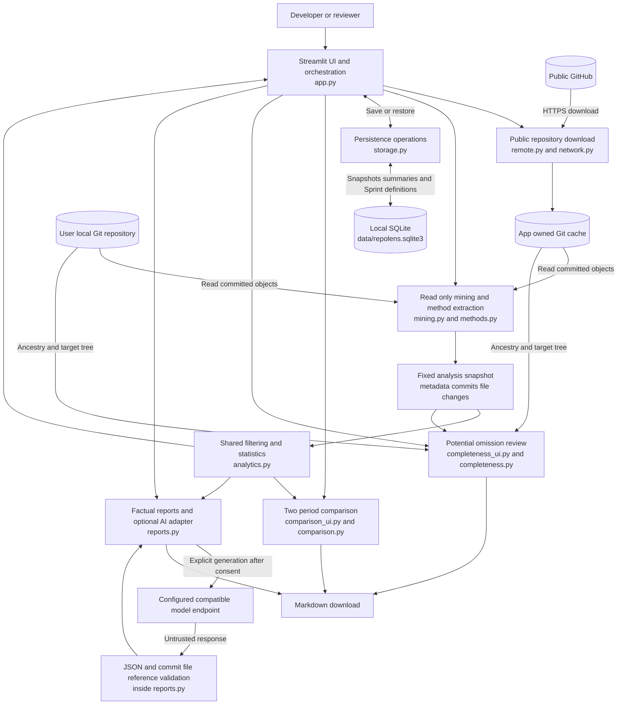

# ChangeGuard Architecture and Design Decisions

## 1 Purpose and baseline

ChangeGuard is a local software-engineering tool for inspecting Git development activity, comparing iteration ranges and reviewing potentially omitted related files. It combines deterministic statistics and co-change suggestions with optional evidence-linked AI summaries.

This document describes the v0.4 implementation at commit `aaa13167feff9485466dc90f5819f405da2efe08`. Prepared on 28 November 2026. The design rationales below are retrospective explanations for team review, not records of approvals that occurred before implementation. No decision is marked as having passed all acceptance checks solely because code or a test exists.

The application is a single-process Streamlit prototype. The component boundaries below organize responsibilities; they are not separately deployed services. Proposed maintenance owners follow the eight-member allocation: M2 architecture/mining, M3 data, M4 shared UI, M5 reports/AI, M6 Sprint comparison, M7 omission detection and M8 verification. M1 coordinates scope and document integration.

## 2 Architecture diagram

This Mermaid diagram renders on GitHub. Arrows show calls or data flow; they do not imply a background queue or a remote database.

`app.py` orchestrates persistence: it explicitly saves and loads snapshots and summaries rather than delegating database access to the report module. The validation box is part of `reports.py`, separated visually to show the boundary around model output. The omission detector is deterministic and does not call the model endpoint.

## 3 Components and data contracts

| Component | Implementation | Responsibility and boundary |
|---|---|---|
| Input | `remote.py`, `network.py`, `mining.py` | Validate sources, inspect branches and download public history to app-owned storage. Windows proxy discovery does not change global Git settings. |
| Collection | `mining.py`, `methods.py` | Resolve a commit list, collect metadata/diffs and extract changed-method positions. No checkout is needed. |
| Snapshot | Dictionary returned by `mine` | `meta` records identity, tip, hashes, options, version and warnings; `commits` and `changes` carry the collected evidence. |
| Analysis | `analytics.py` | Convert records into DataFrames; share inclusive date, author and module filtering across single-period outputs. |
| Persistence | `storage.py` | Transactional snapshot writes, summary cache and repository-scoped Sprint definitions in SQLite. |
| Iteration review | `sprints.py`, `comparison.py`, `comparison_ui.py` | Manage ranges and compare A/B using the same snapshot and common author/module settings. |
| Omission review | `completeness.py`, `completeness_ui.py` | Learn bounded co-change associations from collected ancestors, explain suggestions and export results. |
| Reporting | `reports.py` | Program-calculated reports, bounded AI evidence, reference validation and Markdown generation. |
| Evaluation | `completeness_eval.py`, `scripts/evaluate_completeness.py` | Masked-change replay and a frequency baseline; these measure recovery/ranking, not real-defect accuracy. |

All module paths in this table except `app.py` and `scripts/` are under `repolens/`.

### Important data semantics

- Commit dates are stored in UTC and grouped using the selected display timezone. Filtering is based on committer date and includes both endpoints.
- Authors are identifiers, normally lowercased email addresses; they are not verified people or contribution weights.
- Modules are first-level paths. File counts use paths; renames are not a complete file-identity history.
- Merge inclusion affects commit counts, while per-file merge diffs are not accumulated. Shallow boundary commits without valid parent comparisons are excluded.
- The detector uses the selected target's collected ancestors, independent of the page's date/author/module filters. Candidates must exist in the target tree and must not be touched by the target.

## 4 ADR 01 Read only collection

**Status:** Implemented mechanism; retrospective rationale pending team review.

**Problem.** A developer may inspect an active repository containing local edits and untracked files. Analysis should not switch branches, modify the working tree or write repository configuration. Upstream PyDriller initialization includes a configuration write that this application does not need.

**Decision.** Use `ReadOnlyGit`, which overrides repository opening to avoid that configuration write while retaining PyDriller's committed-object extraction. Resolve and inspect commits through Git rather than checking them out. The detector reads ancestry and the target tree using Git queries. Save application results in the tool's own storage.

**Alternatives considered in this explanation.** Checking out each revision would make source inspection straightforward but disturb the developer's environment. Copying every local repository before analysis would reduce direct exposure but add disk and setup cost. Read-only committed-object access fits the bounded prototype workflow.

**Benefits.** Analysis can run without replacing local files or moving HEAD. Repository history is kept separate from application output. The same approach supports target-tree inspection for the detector.

**Costs and limits.** The adapter depends on an upstream internal initialization boundary and needs regression checks when PyDriller changes. Uncommitted work is excluded. This is an application behavior, not an OS-enforced read-only sandbox; unrelated background Git operations and every possible filesystem access pattern are not covered by a blanket guarantee. Git objects must remain accessible for new mining and original-object queries.

The public-download cache is different from the user's repository: the application is allowed to clone/fetch and update references inside its own cache. Demo generation also intentionally writes to app-owned repositories. These writes do not contradict the local-source read-only decision.

**Verification.** Compare HEAD, symbolic branch, status, tracked and untracked file bytes and configuration before/after analysis in a controlled dirty repository. Relevant existing tests include `test_mining_is_read_only_and_limit_is_explicit`, `test_merge_binary_empty_commit_and_dirty_workspace`, and `test_git_tree_is_at_target_and_source_repository_unchanged`. Their actual assertions define their coverage; add any missing file-byte checks before declaring full acceptance.

## 5 ADR 02 Fixed analysis snapshots

**Status:** Implemented mechanism; retrospective rationale pending team review.

**Problem.** Branch names move. If each chart or report resolves the branch again, users could compare statistics and evidence from different revisions without realizing it.

**Decision.** `analysis_spec` resolves the branch to a commit tip and builds a bounded, fixed list of hashes before mining. It computes the analysis ID from the specification, including repository identity, tip, options and mining version. The UI and reports use saved records rather than independently re-reading a moving branch.

**Alternatives.** Re-reading the branch for every view provides fresher results but makes the evidence unstable and repeats mining. A full immutable repository archive would improve long-term preservation but increase storage and delivery scope. The chosen snapshot stores the bounded evidence needed for the current analysis.

**Benefits.** Charts, details and reports can share one revision and filtering pipeline. Existing analyses remain distinguishable after new commits arrive. The mining version prevents incompatible old cache entries from being mistaken for current-format results.

**Costs and limits.** New commits require a new analysis; a restored snapshot is not a live dashboard. Collection limits and shallow history can omit relevant commits. Diffs and AI inputs can be truncated. An analysis ID identifies the specification; it is not a signature or a full immutable archive. The database can replace a run with the same ID when force-recollecting. Paths and other specification fields can change IDs even when some underlying commit content is the same.

Stored metadata/diffs support revisiting saved results, but new detector ancestry/tree queries still need the local Git repository. A snapshot therefore does not guarantee complete operation after that repository is deleted or pruned.

**Verification.** Independently resolve the selected tip, check collected hashes and limits, round-trip the snapshot through SQLite, move the branch with a controlled new commit and verify that restoring the original run preserves its original tip. Relevant existing tests include `test_mining_is_read_only_and_limit_is_explicit` and `test_database_round_trip_and_report_scope`. Explicit moving-branch/restoration checks should be recorded if not already covered.

## 6 ADR 03 Local SQLite persistence and caching

**Status:** Implemented mechanism; retrospective rationale pending team review.

**Problem.** Mining and model requests may be expensive, and Sprint definitions should survive a UI rerun or restart. The prototype should not require users to operate a database server.

**Decision.** Store snapshots, AI summaries and Sprint definitions in local SQLite. `save_snapshot` writes metadata, commits and changes in one transaction, with structured records serialized as JSON payloads. Run IDs identify snapshots. AI cache keys include payload, normalized endpoint, model and prompt version. Sprint rows are scoped by repository key and unique name.

**Alternatives.** Memory-only state is simple but lost on restart. JSON files would be easy to inspect but require extra coordination for related-record updates and uniqueness. PostgreSQL or another service would support broader deployment needs but introduce operational setup outside the current local prototype.

**Benefits.** A single local file needs no server. Transactions protect related snapshot writes from partial commits. Results and definitions can be reused after restart, and summary caching can avoid identical requests.

**Costs and limits.** JSON payload storage limits relational querying of individual fields. Snapshot restoration still loads and decodes records; caching is not proof of a latency target. SQLite write contention and synchronous processing are not a multi-user design. There is no automatic retention/eviction policy, encrypted-at-rest vault, comprehensive backup mechanism or migration framework claimed here. Database loss removes saved analyses and definitions unless separately backed up.

The AI key does not pin provider-side model behavior forever; the same model ID can change remotely. A manually requested cached summary is a reusable historical result, not a fresh model measurement. Local paths and account-independent cache keys do not supply user isolation.

**Verification.** Round-trip snapshot payloads, reopen the database after restart, test repository-scoped Sprint create/edit/delete and uniqueness, and confirm summary keys change when inputs/model/prompt configuration change. Relevant tests include `test_database_round_trip_and_report_scope`, `test_sprint_persistence_update_duplicate_and_repository_isolation`, and `test_cache_tracks_model_and_input`. Transaction rollback under injected write failure should be separately recorded if claimed.

## 7 ADR 04 Optional AI with factual fallback

**Status:** Implemented mechanism; retrospective rationale pending team review.

**Problem.** Model access can fail, require credentials or return invalid references. Core repository statistics must remain available without a successful model call, and the UI must not present a failed response as accepted evidence.

**Decision.** Keep deterministic statistics and `factual_report` as the default path. Model generation is an explicit opt-in action with sending consent. Build sampled/bounded evidence, request structured output, validate JSON and exact commit/file references, and save only an accepted result. If generation fails, retain the factual report or clearly identify an earlier successful AI summary that remains displayed.

**Alternatives.** Requiring AI for every report makes the core workflow depend on provider availability/cost. Silently accepting free-form output obscures evidence errors. Automatic repeated requests would add cost and unpredictable wait time. The prototype instead exposes errors and permits an explicit retry.

**Benefits.** Git analysis, diffs, Sprint comparison, omission suggestions and factual exports remain independent of model access. Invalid citations do not become a newly successful cached summary. Statistics retain a deterministic source.

**Costs and limits.** Factual fallback has less semantic interpretation. Reference validation confirms existence and pairing, not whether a sentence is true, whether a feature works or whether a change is complete. Sampling/truncation can omit reversals or later deletions. A synchronous request still causes waiting, and no background queue is implemented.

Generation can transmit commit messages, paths, diff fragments and scope fields. `app.py` attaches selected author IDs through `payload.scope`; the existing author-disclosure wording needs field-level verification and possible correction. Consent is not anonymization or automatic secret removal. Report this gap honestly rather than describing local-first operation as a guarantee that no data ever leave the device.

**Verification.** Exercise valid mock responses, malformed JSON, invalid evidence IDs, mismatched references, HTTP failures, timeouts and failure-after-previous-success UI states. Confirm no new successful summary is saved after rejection and factual outputs remain available. Existing evidence includes `test_rejected_ai_output_keeps_factual_report_without_claiming_no_call`, the local HTTP adapter tests and reference/cache tests. Real-model factual evaluation and transmission inspection remain separate tasks.

## 8 Quality attributes and ownership

| Decision | Primary quality goals | Owner and review | Evidence still needed for a broad claim |
|---|---|---|---|
| ADR 01 | Data integrity, non-interference | M2; M8 verifies, M7 checks detector use | Complete controlled before/after state comparisons and upstream-upgrade regression |
| ADR 02 | Consistency, traceability, reproducibility | M2/M3; M5/M6/M7 verify consumers | Explicit branch-move and restoration checks; clearly stated partial-history scope |
| ADR 03 | Repeatability, persistence, reduced repeated work | M3; M6/M5 verify feature caches, M8 verifies restart | Rollback/failure evidence if claimed, clean deployment and actual performance measurements |
| ADR 04 | Graceful failure, evidence traceability, user control | M5; M2 reviews transmission, M8 verifies errors | Real AI claim review, request-field disclosure checks and remaining timeout/failure cases |

This table is not a separate conflicting NFR registry. The broader role-based goals, including performance, portability, testability and explainability, are detailed in material 08. UI appearance alone does not establish portability, and test counts alone do not establish performance or maintainability.

## 9 Verification provenance and open findings

The earlier integration evidence records 90 pytest passes after a process-local loopback proxy correction. The initial 88-pass/2-failure log was preserved. Tests used dependency ranges rather than a demonstrated clean lockfile installation.

The later browser materials record core/Sprint/omission script passes and an initial comparison failure followed by a passing rerun. A temporary Sprint remained after a prior suite reported cleanup; teardown/selection timing needs investigation. Do not infer fully isolated browser tests from the eventual pass.

Evidence references:

- [Integration records at the documented source revision](https://github.com/bahua1220/ChangeGuard/tree/aaa13167feff9485466dc90f5819f405da2efe08/docs/verification/v0.4).
- [Mining implementation](https://github.com/bahua1220/ChangeGuard/blob/aaa13167feff9485466dc90f5819f405da2efe08/repolens/mining.py).
- [SQLite implementation](https://github.com/bahua1220/ChangeGuard/blob/aaa13167feff9485466dc90f5819f405da2efe08/repolens/storage.py).
- [Reporting and validation](https://github.com/bahua1220/ChangeGuard/blob/aaa13167feff9485466dc90f5819f405da2efe08/repolens/reports.py).
- [UI orchestration and fallback](https://github.com/bahua1220/ChangeGuard/blob/aaa13167feff9485466dc90f5819f405da2efe08/app.py).

Current browser execution, screenshots and their specific failure/rerun records are in the locally generated submission-materials package; this file does not claim they are already in the remote evidence directory linked above.

## 10 Decision maintenance

Confirm the rationale and owner for each decision during an actual team review. Record reviewers, date and accepted revision. Future changes should identify the affected ADR, alternatives, quality tradeoff, requirement/acceptance impact and tested commit. Preserve the distinction between implemented behavior, proposed improvement and verified outcome.
